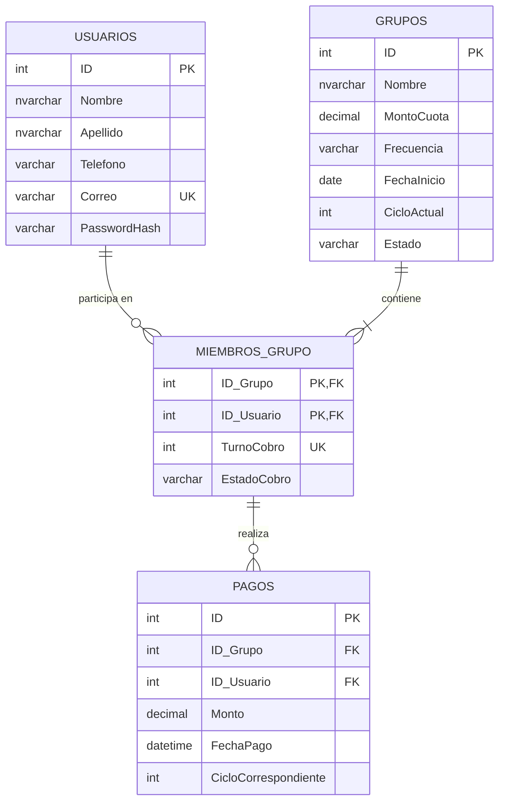
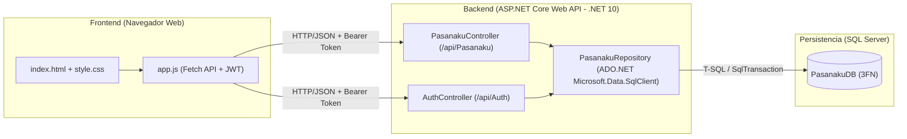
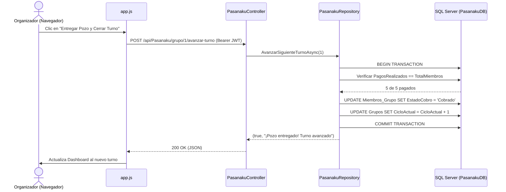

# Diagramas del Sistema — Pasanaku Digital

GitHub renderiza automáticamente los siguientes diagramas en formato **Mermaid**.

## 1. Diagrama Entidad-Relación (Modelo de Datos 3FN)

---

## 2. Diagrama de Componentes y Arquitectura

---

## 3. Diagrama de Secuencia: Entrega de Pozo y Avance de Turno

