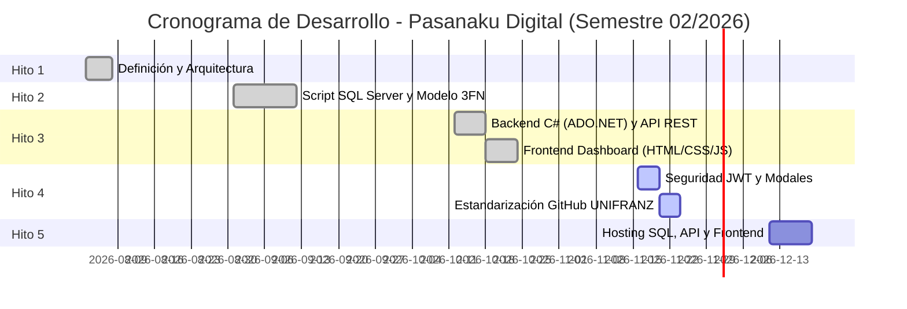

# Planificación del Proyecto y Diagrama de Gantt

## 1. Hitos del Proyecto Semestral

| Hito | Descripción | Fechas | Estado | Responsable |
| :--- | :--- | :---: | :---: | :--- |
| **H1: Análisis y Definición** | Definición del alcance del Pasanaku Digital y selección del stack tecnológico. | 03/ago - 08/ago | Completado | Equipo |
| **H2: Base de Datos 3FN** | Diseño DDL/DML en SQL Server, modelo relacional en 3FN y restricciones de unicidad. | 31/ago - 12/sep | Completado | Sebastián |
| **H3: Backend API y Frontend** | Desarrollo de `PasanakuRepository` (ADO.NET puro) y Dashboard estático Vanilla JS. | 12/oct - 24/oct | Completado | Sebastián |
| **H4: Seguridad y Estandarización** | Autenticación JWT, modales interactivos y estandarización del repositorio GitHub. | 16/nov - 24/nov | En progreso | Equipo |
| **H5: Despliegue en la Nube** | Publicación en producción: SQL Server, API (SmarterASP.NET/Azure) y Frontend (Vercel). | 11/dic - 19/dic | Pendiente | Equipo |

---

## 2. Diagrama de Gantt Actualizado

